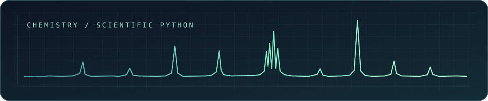

<!-- БАННЕР. Загрузи свою картинку в assets/ и замени путь в src. -->

  

# Привет, я Роман

Учусь на химфаке МГУ. Пишу на Python инструменты для задач из лаборатории — от сопоставления ЯМР-сигналов до подготовки файлов к статье. Интересуюсь органическим синтезом, спектроскопией и хемоинформатикой.

## Избранные проекты

| Проект | Что делает |
| --- | --- |
| [**NMR Structure Ranker**](https://github.com/komhujsob/nmr-structure-ranker) | Ранжирует структуры из библиотеки по списку пиков ¹³C ЯМР и показывает совпавшие сигналы. |
| [**FluoroScreen**](https://github.com/komhujsob/fluoro-screen) | Оценивает максимум эмиссии по SMILES и растворителю, показывает ближайшие аналоги и источники измерений. |
| [**ChemPack**](https://github.com/komhujsob/chempack) | Собирает лабораторные файлы в ZIP с реестром и контрольными суммами. |
| [**Химпрактикум**](https://github.com/komhujsob/chem-precision) | Интерактивный урок про значащие цифры и округление с задачами и объяснениями. |

<!-- ССЫЛКИ. Если захочешь, добавь сюда Telegram, почту или ссылку на сайт. -->
